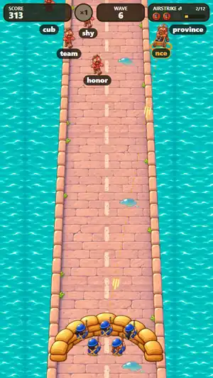

<p align="center">
  
</p>

<p align="center">
  <b>An arcade typing shooter.</b> Enemies march down the road toward your squad.<br>
  Type the words on them to shoot them before they reach the barricade.
</p>

<p align="center">
  <a href="https://rdpharr.github.io/wordfront/"><b>▶ Play in your browser</b></a>
  &nbsp;·&nbsp;
  <a href="https://github.com/rdpharr/wordfront/releases/latest">Download the offline version</a>
</p>

<p align="center">
  <a href="https://github.com/rdpharr/wordfront/actions/workflows/ci.yml"></a>
  <a href="https://github.com/rdpharr/wordfront/releases/latest"></a>
  <a href="LICENSE"></a>
</p>

<p align="center">
  
</p>

Wordfront is free and open source, with no ads, accounts or tracking. It runs in any modern
browser, or you can install the offline version on Windows, macOS or Linux.

## How to play

- **Type a word to shoot it.** The first letter locks on to that enemy (the nearest one, if
  several words start with it), and each right letter fires a shot.
- **Accuracy beats speed.** A wrong letter jams your rifles for a moment and resets your
  streak. Streaks multiply your score.
- **Airstrikes** (<kbd>Enter</kbd>) blast everything near your squad and restart the wave
  with new words. You earn them back by finishing words.
- Watch out for Destroyers' homing missiles and Oppressors' fans of bullets: they carry
  words too.

| Key | Does |
| --- | --- |
| letters | lock on and shoot |
| <kbd>Backspace</kbd> | drop the lock to switch words |
| <kbd>Enter</kbd> | airstrike |
| <kbd>Esc</kbd> | pause |
| <kbd>F11</kbd> | fullscreen |

The game has a full **How to play** screen on the title, pause and game-over screens, and
charts your runs over time.

## The offline version

Download it from the [latest release](https://github.com/rdpharr/wordfront/releases/latest):

| System | File |
| --- | --- |
| Windows | `Wordfront_…_x64-setup.exe` (or the `.msi`) |
| macOS, Apple Silicon (M1 and later) | `Wordfront_…_aarch64.dmg` |
| macOS, Intel | `Wordfront_…_x64.dmg` |
| Linux | `Wordfront_…_amd64.AppImage`, or the `.deb` / `.rpm` |

The installers aren't code-signed (that costs money every year), so your system warns you
the first time:

- **Windows:** "Windows protected your PC" → **More info** → **Run anyway**.
- **macOS:** open it once, then **System Settings → Privacy & Security → Open Anyway**.
  If macOS says the app is damaged, run this in Terminal:
  `xattr -dr com.apple.quarantine /Applications/Wordfront.app`
- **Linux:** `chmod +x Wordfront_*.AppImage`, then run it, or install the `.deb` / `.rpm`.

The offline version tells you when a new version is out and can install it for you.

## Privacy

- No telemetry, no accounts, no ads.
- Your settings and run history stay on your device: in your browser's storage for the web
  version, and in a `Wordfront` folder in your user data folder for the offline version
  (`%APPDATA%` on Windows, `~/Library/Application Support` on macOS, `~/.local/share` on
  Linux). The offline version also keeps gameplay logs there, which you can turn off in
  Options.
- The only network use is the offline version asking GitHub whether a newer release is out
  (turn it off in Options) and downloading it when you choose to install it. The web
  version is hosted on GitHub Pages and makes no other requests.

## Building it yourself

You need [Node.js](https://nodejs.org/) 22. For the desktop app, also
[Rust](https://rustup.rs/) and the [Tauri prerequisites](https://tauri.app/start/prerequisites/)
for your system.

```sh
npm ci
npm run dev        # the game at http://localhost:5199
npm test           # unit tests
npx tauri dev      # the desktop app
```

The dev server and `tauri dev` use the same data folder as the offline version, so test runs
show up in your run history. Set `WORDFRONT_DATA_DIR` to another folder to keep them apart.

Release builds sign their update files with a key only the releases have, so build the
desktop app without them:

```sh
npx tauri build --config src-tauri/no-updater.conf.json
```

Bug reports and ideas are welcome in [Issues](https://github.com/rdpharr/wordfront/issues).

## Support

Wordfront is free. If you enjoy it, you can
[buy me a coffee](https://buymeacoffee.com/rdpharr) ☕

## Licence

- **Code:** [MIT](LICENSE).
- **Art and music:** made with ChatGPT and dedicated to the public domain,
  [CC0 1.0](LICENSE-ASSETS.md). Use them for anything.
- **Word list** (`src/words.txt`): [CC BY-SA 4.0](LICENSE-ASSETS.md), because it's built
  from wordfreq's data. See [CREDITS.md](CREDITS.md) for its sources.
